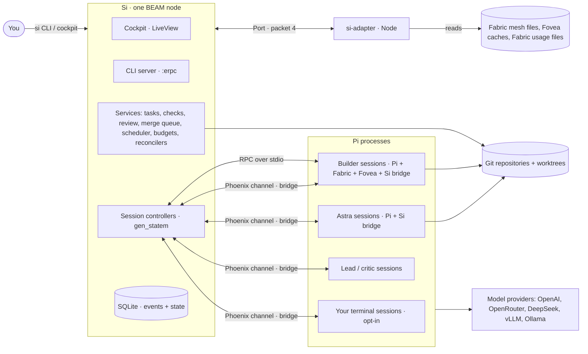
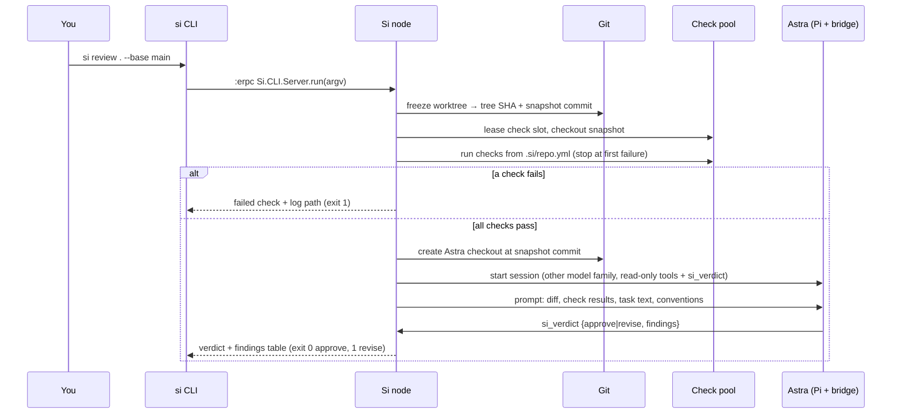
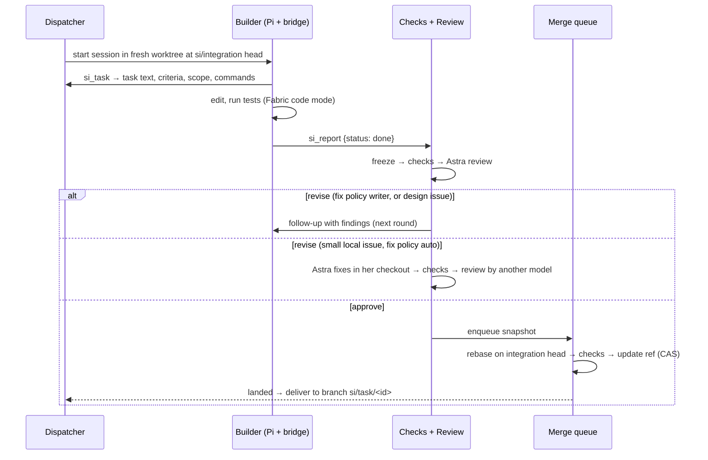
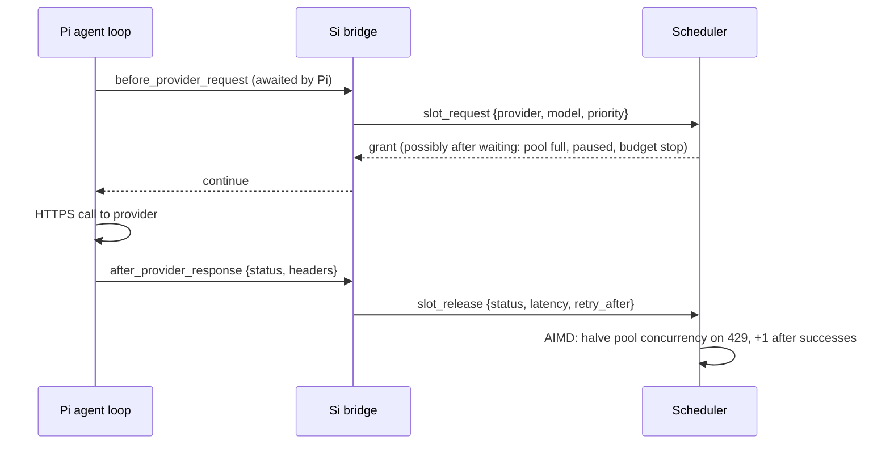

# 01 · Architecture

## 1. System context



- Si is **one BEAM node** (single machine). Everything that decides, remembers or schedules runs there.
- Pi sessions are OS processes. Si starts builder, Astra, Lead and critic sessions itself; your own terminal sessions may join over the bridge if you opt in.
- The only Si code inside Pi is the **Si bridge** extension. The only Si code that reads Fabric's and Fovea's files is the **si-adapter**.

## 2. Layers

| Layer | Name | Responsibility | Main modules |
|---|---|---|---|
| L0 | Processes + reconcilers | Start/stop Pi processes through a runner, warm slots, parking, reconciliation of processes, worktrees, pools | `Si.Runner`, `Si.Runner.Local`, `Si.Reconcilers.*` |
| L1 | Session controllers | One `:gen_statem` per session mirroring Pi's state; safe delivery; usage recording | `Si.Sessions.Controller`, `Si.Pi.Rpc`, `SiWeb.SessionChannel` |
| L2 | Signals | Deterministic signals from events + typed judgments (Jev, Foreman's ten questions) | `Si.Signals`, `Si.Jev` |
| L3 | Lead | Planning, escalations, interventions (one per run) | `Si.Lead`, `Si.Plan` |
| L4 | You | CLI, cockpit, inbox, analytics | `Si.CLI`, `SiWeb.*`, `Si.Inbox` |
| — | Services | Task board, dispatch, checks, evidence, review (Astra), merge queue, delivery, scheduler, budgets, models, learning, evals | `Si.Tasks`, `Si.Checks`, `Si.Evidence`, `Si.Review`, `Si.MergeQueue`, `Si.Delivery`, `Si.Scheduler`, `Si.Budgets`, `Si.Models`, `Si.Learning`, `Si.Evals` |

Implementation is built **bottom-up in these layers**, except that the review service (Astra) is pulled forward to be the first user-facing feature (see `07-build-order.md`).

## 3. Supervision tree

```
Si.Application (one_for_one)
├─ Si.Repo                              Ecto/SQLite
├─ Phoenix.PubSub (name: Si.PubSub)
├─ Registry (keys: :unique, name: Si.Registry)
├─ Task.Supervisor (name: Si.TaskSupervisor)   async work such as tool handlers (T04.07)
├─ Si.Settings                          loads $SI_HOME/config.yml over defaults
├─ Si.Telemetry                         telemetry handlers + OpenTelemetry setup
├─ Si.Git.Locks                         per-repository mutex for git worktree/ref operations
├─ Si.Toolchains                        resolves / installs pinned Pi + Fabric + Fovea
├─ Si.Adapter.Supervisor                (from M10) owns the si-adapter Port
├─ Si.Sessions.Supervisor               DynamicSupervisor
│   └─ Si.Sessions.SessionSup           per session, rest_for_one
│       ├─ Si.Runner.Local.PortOwner    owns the Erlang Port of the Pi process (workers)
│       └─ Si.Sessions.Controller       :gen_statem
├─ Si.Checks.Supervisor                 Task.Supervisor for check runs + CheckPool per repo
├─ Si.Review.Supervisor                 DynamicSupervisor: one ReviewThread per review
├─ Si.Tasks.Dispatcher                  (from M06)
├─ Si.MergeQueue.Supervisor             DynamicSupervisor: one queue per repository (from M06)
├─ Si.Runs.Supervisor                   DynamicSupervisor: one Run gen_statem per run (from M09)
├─ Si.Scheduler                         pools, slots, AIMD (from M08; a pass-through stub before)
├─ Si.Budgets                           (from M08)
├─ Si.Signals.Supervisor                (from M12)
├─ Si.Reconcilers.Supervisor            (from M11)
├─ Si.Inbox
├─ Si.Backups                           (from M11)
├─ Si.CLI.Server                        entry point for `si` over :erpc
└─ SiWeb.Endpoint                       cockpit + bridge socket (127.0.0.1)
```

Children introduced by later milestones are added by the task that builds them. A process that does not exist yet must not be referenced by earlier code.

## 4. Process model and runtimes

| Process | Runtime | Started by | Talks to Si through | Lifetime |
|---|---|---|---|---|
| Si node | BEAM | `bin/si-server` | — | long-lived |
| Builder / Astra / Lead / critic session | Pi (Node or Bun) from a Si toolchain | `Si.Runner.Local` (Erlang Port) | RPC (stdin/stdout JSONL) + bridge (WebSocket) | per task / per review thread |
| Your terminal session | your global `pi` | you | bridge only (opt-in) | yours |
| si-adapter | Node | `Si.Adapter` (Erlang Port, `{:packet, 4}`) | Port | long-lived, restarted by supervisor |
| Check command | whatever the repo profile runs | `Si.Checks.Command` via `MuonTrap.cmd/3` | exit code + log file | per check |

**Runner decision.** Pi sessions run under a plain Erlang Port because Pi RPC needs stdin and Pi shuts down in an orderly way when stdin closes (Pi `docs/rpc.md`, "Close the child's stdin to request an orderly shutdown"). MuonTrap's wrapper keeps stdin for its own control channel and does not forward it, so it is used only for non-interactive check commands, where its process-tree cleanup on timeout is exactly what is needed. Stopping a session: send RPC `abort` if running, close the port, wait 5 s, then `SIGTERM` and after 5 s more `SIGKILL` to the OS pid and its descendants. Sessions start with `--session-dir $SI_HOME/sessions --session-id <ses_id>`: Pi creates the session if it does not exist and reopens it otherwise, so a restart is the same command; the session file path comes from `get_state`.

**Toolchain decision.** Si sessions never use your global `pi`. Si installs pinned versions of Pi, Fabric and Fovea into `$SI_HOME/toolchains/<toolchain_id>/` and starts sessions with `--no-extensions` plus explicit `-e` paths (Fabric, Fovea where the role needs it, the Si bridge). This makes the extension set and versions exact and allows pinning versions per run.

## 5. Key flows

### 5.1 `si review` (Astra, the first feature)



### 5.2 Quick-tier task (single worker)



### 5.3 Model call admission (from M08)



If Si is unreachable, the bridge proceeds after `slot_timeout_ms` so a session never stalls because Si is down.

### 5.4 Landing through the merge queue

1. Queue worktree checks out `si/integration` head `H`.
2. `git cherry-pick <snapshot commit>` (the snapshot commit's parent is its base, so the pick replays exactly the task's change).
3. On conflict: abort, eject the item to its writer with the conflict files.
4. Run `build` + `test_all` from the repo profile on the result.
5. On success: `git update-ref refs/heads/si/integration <new> H` (compare-and-swap; if `H` moved, retry from step 1).
6. Mark the item landed, record the landed SHA, deliver.

## 6. Boundary with Fabric

| Fabric feature | In Si workers | In your own sessions |
|---|---|---|
| Code mode (`fabric_exec`), MCP, memory, schema | On | On |
| Child agents (`agents.run`, councils, swarms, `rlm.query`) | Off: `agents.maxDepth: 0` in the profile's `fabric.json` | On; Si shows them through the adapter (M10) |
| Long-running actors (separate host process) | Off: `mesh.enabled: false` | On; Si shows them through the adapter |
| Worktrees for child agents | Off: Si owns all worktrees | Fabric's own |
| Foreman | Not run; Si uses its ten questions in its own judgments | Yours |
| Mesh | Off | On; read through the adapter |
| Si's `si_*` tools | Kept visible to the model with `capture.keepVisible` and risk class `read` (full code mode would otherwise hide them) | Only `si_ask` |
| Approvals | Your policy, set with `si init` (`profiles.builder.approvals`); builders do not start until it is set; dialogs go to your inbox | Your own Fabric settings |

Every Fabric upgrade is reviewed against this table before its version is pinned (task T11.08).

## 7. State and reliability

- **State tables + append-only event log.** Each context writes its state row(s) and one or more `events` rows in the same `Ecto.Multi` transaction, then broadcasts on PubSub after commit. This gives an audit trail, the ledger and replay for tests without full event sourcing.
- **Six places hold state**: Si's database, running processes, Pi session files, Fabric's mesh (your sessions only), git (worktrees, branches, refs), Fovea caches. Reconcilers (M11) compare desired with observed state and repair idempotently.
- **Everything is restart-safe by design**: controllers rebuild from the `sessions` table and the Pi session file; runs rebuild from their events; queues rebuild from `merge_items`.

## 8. Key decisions

| # | Decision | Rationale |
|---|---|---|
| D1 | Si controls Pi + Fabric sessions; it does not rebuild them | Reuse a working agent loop, providers and code mode. |
| D2 | Astra first: `si review` is the first usable feature | Immediate value, and it reviews the rest of Si's own implementation. |
| D3 | One Pi extension (Si bridge) for events, controls, tools and slot waits | Pi's extension API covers everything needed and loads in every session; Fabric auto-captures Pi tools. |
| D4 | Plain Erlang Ports for Pi sessions; MuonTrap only for check commands | Pi RPC needs stdin; MuonTrap does not forward it. Pi exits on stdin EOF. |
| D5 | Si-managed pinned toolchains; sessions start with `--no-extensions` and explicit `-e` | Exact versions and extension sets per run. |
| D6 | Workers start with `--no-approve` | Project-local Pi settings can't change a worker's pinned extension set, and no trust prompt can block a headless session. `AGENTS.md` still loads. |
| D7 | State tables + event log in one transaction | Auditability and replay without full event-sourcing cost. |
| D8 | Checks run in pooled check worktrees on frozen snapshots | Results bind to an exact tree; parallel checks never collide. |
| D9 | Structured outputs through tools (`si_verdict`, `si_report`, `si_plan`) validated by schema | Robust parsing; `terminate: true` stops the turn after the verdict. |
| D10 | CLI talks to the node over distributed Erlang (`:erpc`) | No extra HTTP API to maintain; streaming output via messages. |
| D11 | si-adapter for Fabric/Fovea internals, same versions as sessions | Elixir never parses other tools' private formats. |
| D12 | Evals with numeric targets decide which features stay on | Every feature must prove it helps. |
| D13 | Every restricted role lists its `si_*` tools in `--tools`; builders keep them visible through Fabric's `capture.keepVisible` | Pi's `--tools` is an allowlist over extension tools too, and Fabric's full code mode hides extension tools. |
| D14 | You choose the builder approval policy at setup; Si enforces that one is set | It is part of the safety topics you will plan; headless sessions must not guess. |
| D15 | Long prompt-cache retention, one cache identity per session, affinity headers where Pi does not send them | "Manage cache like pi-fabric-pair"; Pair-style warming is unavailable on Pi 0.87.1 (Pair F-31). |
| D16 | One Si instance per `$SI_HOME`, running as a background service | Two nodes would corrupt state; reviews and the bridge need Si running. |

### Changes from blueprint v7 (now also in the published v8)

- **Runner**: v7 said "MuonTrap" for L0. MuonTrap does not forward stdin, so Pi sessions use plain Ports (D4).
- **Toolchains**: new. Si installs pinned Pi/Fabric/Fovea instead of using the global `pi` (D5).
- **Build order**: Astra is now the first user-facing milestone (M05), before task dispatch.

### Changes after the plan review (27 Sep 2026)

- Session start flags: `--session-dir` + `--session-id` (was `--session <path>`, which only opens existing sessions).
- Tool allowlists include the `si_*` tools (and Fovea's tools for the Lead); builders keep the `si_*` tools visible with Fabric's `capture.keepVisible`.
- Pair audit lessons applied: long `prompt`/`compact` deadlines extended by compaction events (F-06); oversized RPC records skipped instead of killing the session, and a session-size watch (F-05); a `compacting` flag that holds deliveries (F-22); freeze exclusions and retries that never stop the worker (F-15, F-16); interim cost caps before budgets exist (F-17); retention (F-30). The full mapping is in `09-pair-audit-coverage.md`.
- New tasks: cockpit access protection (T00.12), `si init` with the approval-policy choice and a user guide (T05.11), reviews, tasks and runs from the browser (T05.12, T06.09, T09.12), cache discipline (T08.09), retention and `si gc` (T11.11), release build and background service (T11.12). Also `si fix` for quick fixes and a single-instance guard.
